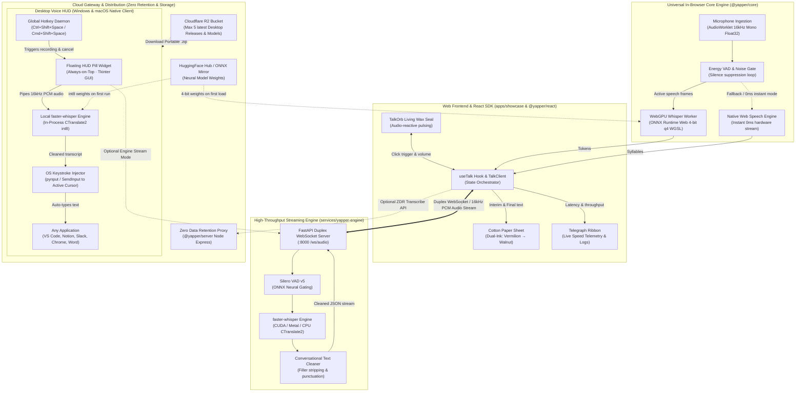
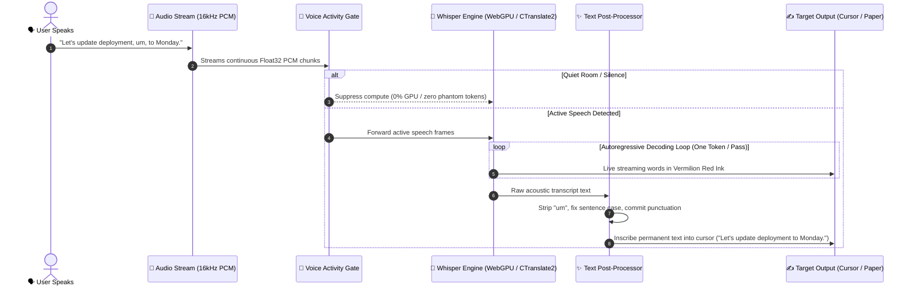

# Yapper

> *"Speak softly. Your voice writes itself into thought."*
> **An intimate, zero-latency speech-to-text SDK running 100% on-device Whisper via WebGPU with self-healing 0ms Native Web Speech fallback.**
> *Live interactive playground:* [**yapper.plaatoos.com**](https://yapper.plaatoos.com)

[](https://opensource.org/licenses/MIT)
[](https://developer.mozilla.org/en-US/docs/Web/API/WebGPU_API)
[](https://vitest.dev)
[](https://huggingface.co/onnx-community/whisper-tiny)
[](#-security--privacy-invariants)
[](FUTURE_PLANS.md)

---

`Yapper` is an open-source, dual-architecture speech-to-text SDK built for modern web applications. Inspired by the intimate letterpress aesthetic of the film *Her* (Theodore Twombly's "Beautiful Handwritten Letters"), Yapper gives developers zero-latency, private voice dictation that feels like living ink on cotton paper.

---

## 🧠 The 10-Second Mental Model

```
┌──────────────────────────────────────────────────────────────────────────────┐
│ 1. YOU SPEAK      ──> 🎤 16kHz Mono Float32 AudioWorklet / sounddevice       │
│ 2. VAD GATES      ──> 🛑 Energy VAD suspends compute on quiet pauses (0% GPU)│
│ 3. DECODER INKS   ──> ⚡ WebGPU Whisper (in browser) or faster-whisper       │
│                       (Desktop HUD) decodes words token-by-token             │
│ 4. CLEANUP        ──> ✨ Post-processor strips "um/uh", fixes capitalization │
│ 5. EMISSION       ──> ✍️ Streams in pulsing Vermilion ink on web paper,      │
│                       or auto-types into cursor in VS Code, Notion, Slack    │
└──────────────────────────────────────────────────────────────────────────────┘
```

### 🎯 Which Component Do I Need?

| If You Want To... | Target Component | Technology | Offline? | Guide |
| :--- | :--- | :--- | :---: | :--- |
| **Dictate into VS Code, Notion, Slack anywhere on OS** | [`clients/desktop_hud.py`](clients/README.md) | Python / OS Hook | **100% Offline** | [Desktop Guide](clients/README.md) |
| **Add voice dictation to a React / Next.js app** | [`packages/react`](packages/react/README.md) | TypeScript / React 18+ | **100% Offline** | [React Guide](packages/react/README.md) |
| **Add voice dictation to Vanilla JS, Vue, or Svelte** | [`packages/core`](packages/core/README.md) | TypeScript (0 deps) | **100% Offline** | [Core Guide](packages/core/README.md) |
| **Run a high-throughput WebSocket streaming backend** | [`services/yapper-engine`](services/yapper-engine/README.md) | Python 3.12 / FastAPI | Local or Cloud | [Engine Guide](services/yapper-engine/README.md) |
| **Try the interactive WebGPU playground right now** | [`apps/showcase`](https://yapper.plaatoos.com) | React / WebGPU | Web Browser | [Live Demo](https://yapper.plaatoos.com) |

---

## ✨ Key Highlights

- ✦ **On-Device WebGPU Whisper (Fast 4-bit)**: Compiles OpenAI's Whisper model directly into your browser's GPU shaders via ONNX Runtime Web and `@huggingface/transformers`. Model weights are compressed with 4-bit integer quantization (`q4`), slashing download size to **28 MB** and executing inference in **~60ms to 95ms**.
- ⚡ **Instant Native Speech (0ms)**: Instant hardware-accelerated speech recognition served directly by the browser's native Web Speech API (`webkitSpeechRecognition`) with a self-healing auto-restart supervisor loop. Zero download, zero GPU load, instant 60fps word streaming.
- ⏱️ **Real-Time Latency & Speed Telemetry**: Live microsecond-level decode pass latency, tokens-per-second throughput tracking, and commit duration metrics.
- ✍️ **Living Stationery UI**: Tactile cotton paper canvas, an audio-reactive living wax-seal voice orb (`<TalkOrb />`), a sliding hardware controls drawer, and continuous manuscript accumulation where speech writes in vermilion red ink before drying into permanent walnut ink.
- 🛡️ **Zero Cloud Transmission**: By default, audio samples never leave the user's device. Audio buffers reside in transient RAM, run through Web Audio nodes, and are immediately freed after decoding.
- 🧪 **Automated Vitest Test Suite**: 100% verified test coverage across audio downsampling, WAV header generation, Energy VAD, and streaming agreement chunking.
- 🌍 **Multilingual**: Supports 55+ spoken tongues including English, Spanish, Polish, French, German, Korean, Italian, Ukrainian, and more.

---

## 🏗️ Architecture & Component Interconnections

Yapper connects an audio-reactive **Web & React Client SDK**, an in-browser **Universal WebGPU Core Engine**, a cross-platform **Desktop Voice HUD**, an authoritative **Python WebSocket Streaming Microservice**, and an edge-cached **Cloud Distribution Layer**:



### Component Interconnection Breakdown

1. **Desktop Voice HUD ↔ Target Applications**:
   - The global keyboard hook listens for `<ctrl>+<shift>+<space>` (Windows) or `<cmd>+<shift>+<space>` (macOS).
   - Upon trigger, the HUD records audio via `sounddevice`, passes frames to in-process `faster-whisper`, formats the text, and injects characters at the active OS cursor via `pynput` / `SendInput` into VS Code, Notion, Slack, Word, or Chrome.

2. **Web Frontend (`@yapper/react`) ↔ Core Engine (`@yapper/core`)**:
   - The `<TalkOrb />` visualizer pulses reactively to live microphone amplitude.
   - `AudioWorklet` captures 16 kHz Mono Float32 PCM audio directly in the browser thread.
   - `EnergyVAD` computes Root Mean Square (RMS) energy; during pauses, GPU tensor dispatch is halted to prevent idle power draw and token loops.
   - `WebGPU Whisper Worker` runs 4-bit quantized Whisper weights in WGSL shaders via ONNX Runtime Web, streaming interim hypothesis tokens into the Cotton Paper Sheet in vermilion red ink before committing permanent walnut ink.

3. **Client SDK ↔ Python Streaming Engine (`services/yapper-engine`)**:
   - For server-side high-throughput workloads, `TalkClient` connects via duplex WebSocket to `ws://localhost:8000/ws/audio?language=en&mode=flow`.
   - The engine processes incoming audio chunks through `Silero VAD`, decodes using `faster-whisper` (CTranslate2), applies `ConversationalTextFormatter` to clean filler words and format punctuation, and sends JSON interim/final frames back over the socket.

4. **Cloud Distribution & Zero Data Retention (`Cloudflare R2` & `@yapper/server`)**:
   - Pre-compiled standalone desktop releases (`Yapper-windows-x64.zip` and `Yapper-macos.zip`) are distributed via Cloudflare R2 with an automated retention limit of the latest 5 builds.
   - The lightweight `@yapper/server` gateway acts as an end-to-end encrypted proxy with zero disk writes, enforcing a Zero Data Retention guarantee.

### 🔄 Life of a Spoken Word (End-to-End Sequence)

The diagram below traces the exact journey of a spoken syllable through VAD gating, autoregressive decoding, and text injection:



---

## ⚡ Architecture Comparison

| Capability | In-Browser WebGPU Whisper | Native Web Speech API | Python Streaming Engine (`yapper-engine`) | Cloud Gateway (ZDR Proxy) |
| :--- | :---: | :---: | :---: | :---: |
| **Server Cost** | **$0.00 (Zero)** | **$0.00 (Zero)** | **$0.00 (Local)** or Cloud API cost | Pay-per-token API cost |
| **Data Privacy** | **100% Client-Side** | Cloud (Browser vendor) | **100% On-Premises** (Local Faster-Whisper) | End-to-end encrypted, zero retention |
| **VAD & Denoising** | Client Energy VAD | Browser hardware | **Silero VAD ONNX + STFT Spectral Denoise** | None |
| **Post-Processing** | None (Raw Whisper) | Raw browser transcript | **Natural Speech Cleaner (Filler removal & repair)** | None |
| **Latency** | **~60ms – 120ms** (WebGPU) | **0ms – 50ms** (Instant) | **40ms – 140ms** (CTranslate2 / Groq LPU) | 150ms – 300ms |
| **Accuracy** | High (Whisper Tiny/Base) | Medium | **State of the Art** (Whisper Large v3) | Very High (Whisper Large) |
| **Deployment** | Zero install (Browser) | Any supported browser | **Docker (<80MB RAM)** / Python 3.12 | Node.js Express |

---

## 💾 Model Inventory & Hardware Sizing Matrix

Yapper supports two primary deployment topologies: **100% Offline Edge Execution** (zero cloud reliance or API costs) and **Ultra-Light Cloud Proxying** (<80MB RAM idle).

### Model Size & Resource Specifications

| Component / Subsystem | Model / Framework | Parameters | Disk Storage | Active RAM / VRAM | Execution Target |
| :--- | :--- | :---: | :---: | :---: | :---: |
| **VAD Gating** | Silero VAD v4/v5 ONNX | 1.8M | **1.8 MB** | ~30 MB RAM | CPU (ONNX Runtime) |
| **In-Browser STT** | `whisper-tiny` (4-bit q4) | 39M | **28 MB** (cached) | ~100 MB RAM | Client WebGPU / WASM |
| **In-Browser STT** | `whisper-base` (4-bit q4) | 74M | **58 MB** (cached) | ~160 MB RAM | Client WebGPU / WASM |
| **Local STT (Default)** | Faster-Whisper `tiny.en` | 39M | **75 MB** | ~150 MB RAM | CPU / CUDA (int8) |
| **Local STT (Standard)**| Faster-Whisper `base.en` | 74M | **145 MB** | ~250 MB RAM | CPU / CUDA (int8) |
| **Local STT (Accurate)**| Faster-Whisper `small.en`| 244M | **480 MB** | ~800 MB RAM | CPU / CUDA (int8/fp16) |
| **Local STT (State of the Art)**| Faster-Whisper `large-v3-turbo` | 809M | **1.6 GB** | ~2.5 GB VRAM | NVIDIA CUDA / Apple MPS |
| **Speech Cleaner (Deterministic)** | Rule Engine & Regex Repair | N/A | **0 MB** | <5 MB RAM | Python CPU runtime |
| **Speech Cleaner (Local SLM)**| Qwen2.5-0.5B / Llama-3.2-1B | 0.5B–1B | **400 MB – 1.1 GB** | ~0.8 GB – 1.5 GB | Ollama / vLLM / llama.cpp |
| **Cloud Inference** | Groq / OpenAI Whisper & LLM | Remote | **0 MB** | <80 MB RAM | Cloud API Gateway |

### Deployment Footprint Profiles

| Profile | Target Architecture | Disk Space Required | RAM / VRAM Needed | Offline Capability | Recommended Hardware |
| :--- | :--- | :---: | :---: | :---: | :--- |
| **1. Ultra-Light Cloud** | Desktop HUD + Groq / OpenAI | **~50 MB** (code only) | **< 100 MB RAM** | Requires Internet (API) | Any laptop, mini PC, or Docker container |
| **2. Edge Local (Default)**| Desktop HUD + Local Faster-Whisper | **~80 MB** | **~200 MB RAM** | **100% Offline** | Standard Intel/AMD CPU or Apple Silicon |
| **3. Studio Offline Pro** | Dictation + Large-v3-Turbo + SLM | **~2.7 GB** | **~4.0 GB VRAM/RAM** | **100% Offline** | PC with GPU (GTX 1660 / RTX 3060+ or M-series Mac) |
| **4. In-Browser Client**   | Web app (`yapper.plaatoos.com`) | **~28 MB** (browser cache) | **~120 MB RAM** | **100% Offline** (after load) | Chrome, Edge, Brave, or Firefox with WebGPU |

> [!NOTE]
> **Model Cache Locations**:
> - Faster-Whisper weights are saved automatically on initial inference to `~/.cache/huggingface/hub/` (Windows: `%USERPROFILE%\.cache\huggingface\hub\`).
> - In-browser WebGPU models are cached locally in the browser's [Cache Storage API](https://developer.mozilla.org/en-US/docs/Web/API/CacheStorage) and can be removed at any time via the `<LocalModelCard />` UI.

---

## 📦 Monorepo Architecture

```
yapper/
├── packages/
│   ├── core/           # @yapper/core: Universal framework-agnostic Web Audio & Whisper engine
│   ├── react/          # @yapper/react: React hooks (useTalk) & living UI components (TalkOrb, LocalModelCard)
│   └── server/         # @yapper/server: Lightweight Zero Data Retention Node/Express cloud proxy
├── services/
│   └── yapper-engine/  # Production async Python 3.12 / FastAPI streaming engine (Silero VAD, Local / OpenAI / Groq / vLLM, Speech Cleaner)
├── clients/
│   ├── desktop_hud.py  # Floating desktop voice pill widget (global hotkey & cursor text typing)
│   └── run_desktop_hud.bat # Windows launcher script
└── apps/
    └── showcase/       # Production Vite web application deployed to yapper.plaatoos.com
```

---

## 🚀 Quickstart

### 1. React (`@yapper/react`)

```bash
yarn add @yapper/react @yapper/core
# or
npm install @yapper/react @yapper/core
```

```tsx
import React, { useState } from 'react';
import { useTalk, TalkOrb, LocalModelCard } from '@yapper/react';

export function LetterCompanion() {
  const [transcript, setTranscript] = useState('');

  const {
    isListening,
    isTranscribing,
    audioLevel,
    interimText,
    modelProgress,
    start,
    stop,
    downloadModel,
    removeModel,
  } = useTalk({
    preferredEngine: 'auto', // 'local' (WebGPU Whisper) | 'browser' (Native)
    modelSize: 'tiny',       // 28MB fast 4-bit Whisper
    language: 'english',
    onFinal: (sentence) => {
      setTranscript((prev) => (prev ? `${prev} ${sentence}` : sentence));
    },
  });

  return (
    <div className="flex flex-col items-center gap-6 p-8 bg-[#FAF6EE] text-[#251C17]">
      {/* Living Wax-Seal Voice Orb */}
      <TalkOrb
        size="lg"
        isListening={isListening}
        isProcessing={isTranscribing}
        audioLevel={audioLevel}
        onClick={isListening ? stop : start}
      />

      {/* Real-Time Manuscript Paper */}
      <div className="w-full max-w-xl p-6 bg-white border border-stone-200 rounded-2xl shadow-sm font-serif text-lg leading-relaxed">
        {transcript && <span>{transcript} </span>}
        {interimText && <span className="text-red-600 italic animate-pulse">{interimText}</span>}
      </div>

      {/* Model Download & Cache Management */}
      <LocalModelCard
        progress={modelProgress}
        modelSize="tiny"
        approxMb={28}
        onDownload={downloadModel}
        onRemove={removeModel}
      />
    </div>
  );
}
```

---

### 2. Vanilla JavaScript / TypeScript (`@yapper/core`)

```typescript
import { TalkClient } from '@yapper/core';

const client = new TalkClient({
  preferredEngine: 'auto',
  modelSize: 'tiny',
  language: 'english',
  onAudioLevel: (level) => {
    // Volume level 0.0 to 1.0 at ~60fps
  },
  onInterim: (words) => {
    console.log('Live words as spoken:', words);
  },
  onFinal: (sentence) => {
    console.log('Committed sentence:', sentence);
  },
});

// Start listening (requests microphone and resumes Web Audio graph)
await client.start();

// Stop listening and finalize transcription
const fullTranscript = await client.stop();
console.log('Letter complete:', fullTranscript);
```

---

### 3. Optional Zero Data Retention Gateway (`@yapper/server`)

For teams requiring a centralized proxy endpoint with guaranteed zero disk logging:

```bash
cd packages/server
yarn install
OPENAI_API_KEY=your_key yarn start
```

Transcribe audio with payload magic-byte validation:

```bash
curl -X POST http://localhost:8089/api/transcribe \
  -F "file=@speech.wav" \
  -F "language=en"
```

---

### 4. Production Python Streaming Engine (`services/yapper-engine`)

For high-throughput real-time streaming with Silero VAD gating, DSP spectral noise subtraction, Faster-Whisper/OpenAI/Groq inference, and conversational speech text cleanup:

```bash
cd services/yapper-engine

# Build and run with Docker (100% Free Local mode by default)
docker build -t yapper-engine .
docker run -d -p 8000:8000 --memory=512m yapper-engine

# Check health metrics
curl http://localhost:8000/health
```

Stream 16kHz PCM audio chunks over duplex WebSocket:
```
ws://localhost:8000/ws/audio?language=en&mode=flow
```

---

### 5. Desktop Floating Voice HUD

An always-on-top, draggable desktop voice pill widget that floats over any application (VS Code, Cursor, Notion, Slack, Word, Chrome). Press `Ctrl+Shift+Space`, speak your thoughts, and Yapper transcribes, removes filler words, and types the text directly at your cursor.

#### Launching the HUD:
```bash
# 1. Start the engine backend (terminal 1)
cd services/yapper-engine
python -m src.main
# (or with docker: docker run -p 8000:8000 yapper-engine)

# 2. Launch the Desktop HUD (terminal 2 or double-click run_desktop_hud.bat)
python clients/desktop_hud.py
```

* **Workflow**: Put your cursor in any active app $\to$ Hit `Ctrl+Shift+Space` $\to$ Speak naturally $\to$ Hit `Ctrl+Shift+Space` again $\to$ Text is automatically typed into your cursor.
* See [clients/README.md](clients/README.md) for full configuration, hotkey customization, and active cursor injection details.

---

## 🛡️ Security & Privacy Invariants

1. **Zero Disk & Zero Cloud Logging**: Audio in `local` mode never crosses the network. When using `@yapper/server`, audio is held solely in volatile RAM during the lifetime of the HTTP request and is purged immediately upon response completion.
2. **Deterministic Bounded Generation**: Interim streaming passes enforce greedy decoding (`num_beams: 1`, `temperature: 0`) and cap tokens (`max_new_tokens: 64`) to eliminate infinite autoregressive loops and hallucination tokens on background silence.
3. **AudioContext Autoplay Safety**: Web Audio contexts are proactively verified and resumed upon user gesture, preventing silenced frequency bin loops in modern strict browser environments.
4. **Hardware Rate Adaptation**: The built-in `downsampleTo16k()` utility safely decimates any hardware DAC sample rate (44.1 kHz, 48 kHz, 96 kHz) into exact 16 kHz mono PCM, eliminating container decoding errors.

---

## 🛠️ Development

```bash
# Clone the repository
git clone https://github.com/luisenriquecgongora/yapper.git
cd yapper

# Install monorepo dependencies
yarn install

# Run the showcase development server (port 5173)
yarn dev

# Compile all workspaces (core, react, server, showcase)
yarn build
```

---

## 🚀 Releases & Cloudflare R2 Retention Policy

Yapper Desktop binaries and bundled model assets are published to Cloudflare R2 object storage:

* **CDN Base URL**: `https://pub-091afdf4a9bd47fa9b641aae923852e1.r2.dev`
* **Canonical Latest Windows**: `https://pub-091afdf4a9bd47fa9b641aae923852e1.r2.dev/yapper/latest/Yapper-windows-x64.zip`
* **Canonical Latest macOS**: `https://pub-091afdf4a9bd47fa9b641aae923852e1.r2.dev/yapper/latest/Yapper-macos.zip`
* **Update Manifest**: `https://pub-091afdf4a9bd47fa9b641aae923852e1.r2.dev/yapper/latest/version.json`

### 🛡️ Max-5 Version Retention Rule
To keep Cloudflare R2 storage lean and cost-efficient, an automated retention policy is enforced across release repositories (`yapper/` and `robot-host/stable/`):
- Only the **5 most recent semantic versions** (e.g., `v1.0.0`, `v0.7.0`, `v0.6.3`...) are kept in immutable release storage.
- Older versions are pruned automatically during `python scripts/publish_release_to_r2.py` or via standalone execution with `python scripts/prune_r2_releases.py --all`.
- Canonical folders (`latest/`, `latest.json`, and pre-cached `models/`) are permanently protected from deletion.

---

## 📄 License

MIT © Luis Enrique.
