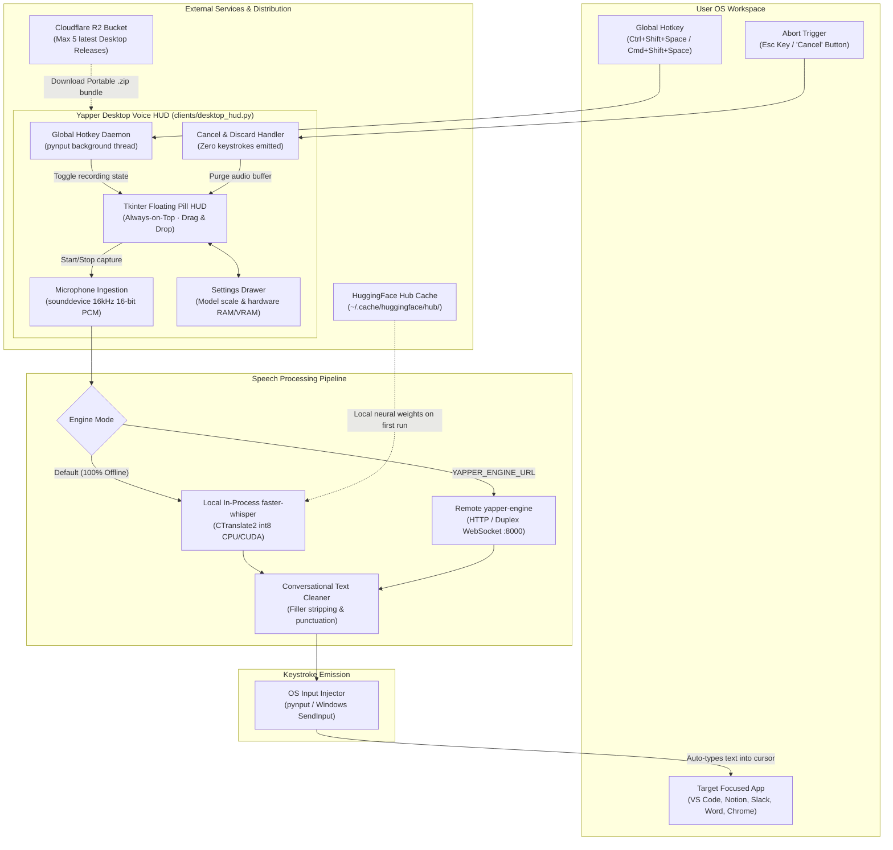

# 🎙️ Yapper Desktop HUD (`clients/`)

> **Floating desktop voice pill widget. Speak anywhere in Windows & macOS (VS Code, Notion, Slack, Word, Chrome), and Yapper transcribes, removes filler words, and types directly at your active cursor.**

[](#-how-it-works)
[](#-global-hotkey-workflow)
[](#-active-cursor-injection)

---

## ⚡ How It Works

The **Yapper Desktop HUD** is an ultra-lightweight, always-on-top tactile floating widget inspired by the letterpress aesthetic of *Her*.

1. **Global Hotkey Listening**: A background listener (`pynput`) listens for `Ctrl+Shift+Space` (Windows) or `Cmd+Shift+Space` (macOS) globally across your entire OS.
2. **Low-Latency Microphone Capture**: When activated, `sounddevice` streams 16kHz 16-bit PCM audio directly from your microphone into memory.
3. **Cancellation Safety**: Pressing `Esc` or clicking the Cancel button immediately flushes memory buffers and returns to idle without typing a single character.
4. **Backend Processing & Cleanup**: Audio is processed through local `faster-whisper` (or remote `yapper-engine`), where Silero VAD gating, speech recognition, and natural conversational cleanup (filler word removal and punctuation formatting) take place.
5. **Active Window Injection**: The cleaned transcript is typed directly into whichever application has focus (**VS Code, Notion, Slack, Word, or Chrome**) via `pynput` / Windows `SendInput`.

---

## 🏗️ Architecture & Component Interconnections

The following diagram illustrates how the desktop HUD client functions, how it intercepts OS input, and which services it connects to:



### Connected Services & Protocols
- **Local In-Process Engine (`faster-whisper`)**: By default, the HUD runs completely offline. It initializes CTranslate2 directly in Python memory and caches model weights (`tiny.en`, `base.en`, etc.) in `~/.cache/huggingface/hub/`.
- **Remote Streaming Engine (`services/yapper-engine`)**: When configured with `YAPPER_ENGINE_URL=http://localhost:8000`, the HUD dispatches recorded PCM audio over WebSocket/HTTP to the FastAPI microservice for server-side GPU decoding.
- **Cloud Distribution (`Cloudflare R2`)**: Pre-packaged standalone ZIP bundles (`Yapper-windows-x64.zip` and `Yapper-macos.zip`) are published to Cloudflare R2 with an automated 5-version retention limit.

---

## 🚀 Quickstart

### 1. Requirements

Install the client dependencies (or use the monorepo root environment):
```bash
pip install -r clients/requirements.txt
```

*(Note: `tkinter` is included with standard Python on Windows).*

### 2. Launch the HUD

#### Option A: Double-Click Batch File (Windows)
Double-click [`clients/run_desktop_hud.bat`](run_desktop_hud.bat) in Windows Explorer.

#### Option B: Terminal
```bash
python clients/desktop_hud.py
```

---

## 🎮 Controls & Workflow

1. **Position the Widget**: Click and drag the floating paper pill anywhere on your screen. It remains persistent and on top.
2. **Focus Any Application**: Click your cursor into any text input:
   - VS Code / Cursor code editor
   - Slack, Discord, or Teams message box
   - Notion or Obsidian document
   - Microsoft Word / Google Docs
   - Web browser search bars or emails
3. **Press `Ctrl+Shift+Space` to Speak**:
   - The indicator dot pulses red: `Listening...`
   - Speak your thoughts naturally with hesitation, filler words, or stutters.
4. **Press `Ctrl+Shift+Space` to Inscribe**:
   - The indicator dot turns amber: `Flow Inking...`
   - Automatic text cleanup strips `um`, `uh`, fixes self-corrections (e.g. *"three files, actually four"* $\to$ *"Four files"*), and capitalizes punctuation.
   - The formatted sentence is automatically typed into your cursor.
5. **Dismiss**: Click the `✕` button on the right edge of the pill.

---

## ⚙️ Configuration

Set custom environment variables before launching:

| Variable | Default | Description |
| :--- | :---: | :--- |
| `YAPPER_ENGINE_URL` | `http://localhost:8000` | Address of running `yapper-engine` server |
| `SAMPLE_RATE` | `16000` | Audio sampling frequency in Hz |

Example:
```bash
set YAPPER_ENGINE_URL=http://localhost:8000
python clients/desktop_hud.py
```
