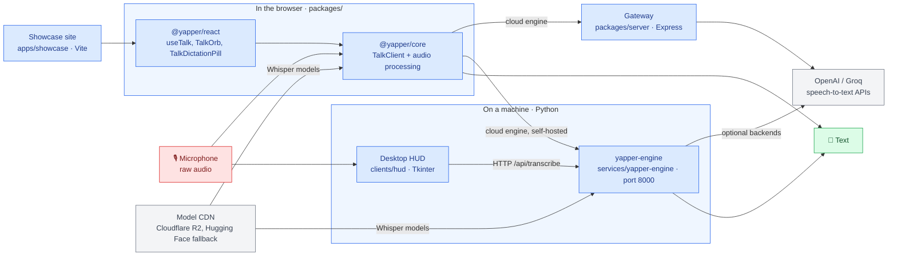
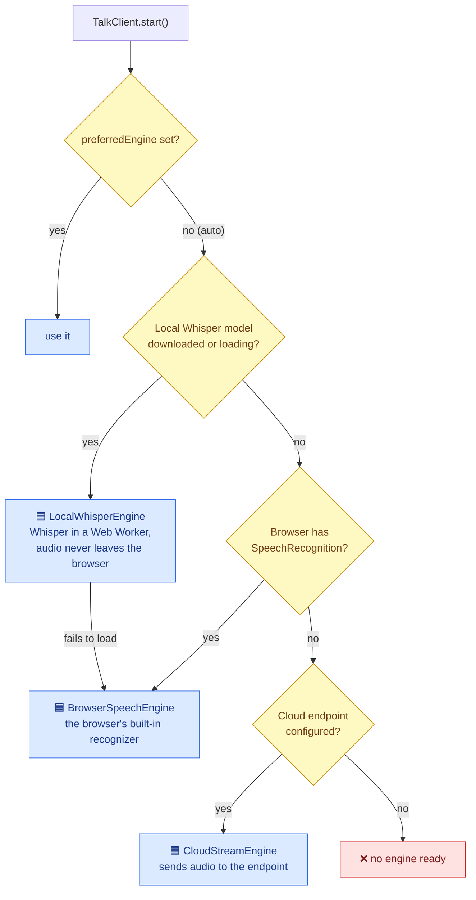
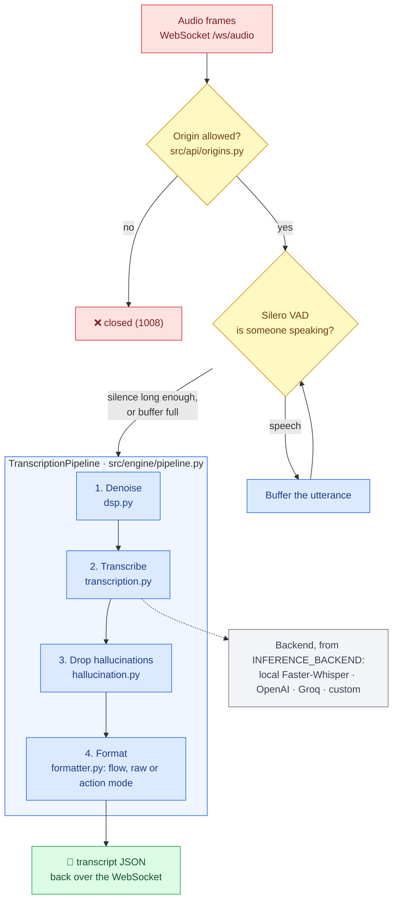
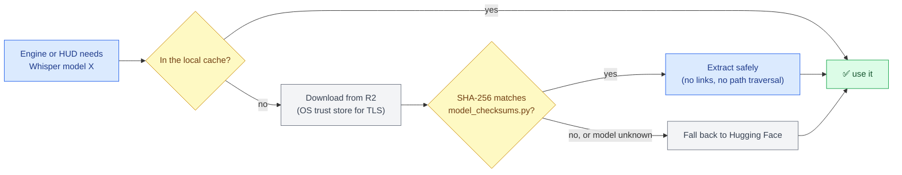

# Architecture

The map of Yapper: what its parts are, how a spoken sentence becomes text, and where to change what.
Keep it current: a change that adds, removes or rewires a part updates the diagram in the same pull request
(`AGENTS.md`, section 11).

## Color palette

| Color | Meaning |
| :--- | :--- |
| 🟦 Blue | Our code: packages, services, apps |
| 🟪 Purple | Inputs: microphone, configuration |
| 🟨 Yellow | Checks and decisions |
| 🟩 Green | Outputs: text, downloaded models |
| ⬜ Grey | External systems we do not own |
| 🟥 Red | Personal data: raw audio and transcripts |

## The big picture

Yapper turns speech into text. It has two halves: **browser libraries** that web apps embed, and a **Python
engine** that does the heavy transcription. Both can also call cloud providers.

**Audio and transcripts are personal data** (red). Nothing stores or logs them beyond the request: the engine
and the gateway transcribe and forget. Audio leaves the machine only when a cloud backend (OpenAI, Groq) is
chosen. The engine accepts browser requests only from localhost pages and the origins in `CORS_ORIGINS`.

## How the browser picks an engine

`TalkClient.resolvedEngine` in `packages/core/src/TalkClient.ts` picks one of three engines, unless the app
sets `preferredEngine`:

Before any engine sees it, `packages/core/src/audio/` downsamples the microphone to 16 kHz mono with an
AudioWorklet (inline code in `audioProcessor.ts`) and detects speech by energy.

## One utterance through the engine

`services/yapper-engine` receives 16 kHz, 16-bit mono audio on the WebSocket `/ws/audio` (streaming) or
`POST /api/transcribe` (one file):

`INFERENCE_BACKEND=auto` picks a cloud backend when its API key is set, otherwise local Faster-Whisper.

## How models are downloaded

`scripts/upload_models_to_r2.py` publishes a model and rewrites `model_checksums.py` with its hash; the two are
always committed together (`publish-model` skill).

## Parts

| Part | Folder | What it does | Talks to |
| :--- | :--- | :--- | :--- |
| Core library | `packages/core` | `TalkClient`, audio processing, the three browser engines, streaming agreement | Gateway, engine, model CDN |
| React library | `packages/react` | `useTalk` hook and ready-made components | Core |
| Gateway | `packages/server` | Express proxy to OpenAI / Groq / self-hosted Whisper; stores no audio | Cloud APIs |
| Showcase | `apps/showcase` | Marketing and demo site (`src/App.tsx`) | React library |
| Engine | `services/yapper-engine` | FastAPI: `GET /health`, `POST /api/transcribe`, WebSocket `/ws/audio` | Backends, model CDN |
| Desktop HUD | `clients/hud`, `clients/desktop_hud.py` | Records audio, transcribes through the engine or in-process | Engine |
| Scripts | `scripts/` | Release builds, R2 publish and model upload, `doctor.py`, `verify.py` | R2 |

## Where to change what

| To change... | Look in | Skill |
| :--- | :--- | :--- |
| Add or change a transcription backend | `services/yapper-engine/src/engine/transcription.py`, `config.py` | `.agents/skills/add-stt-backend` |
| Publish or fix a model download | `scripts/upload_models_to_r2.py`, `model_loader.py` | `.agents/skills/publish-model` |
| How the browser picks an engine | `packages/core/src/TalkClient.ts` | `.agents/skills/review-change` |
| Cleanup of the text (fillers, actions) | `services/yapper-engine/src/engine/formatter.py` | `.agents/skills/review-change` |
| Which websites may call the engine | `CORS_ORIGINS`, `src/api/origins.py` | `.agents/skills/review-change` |
