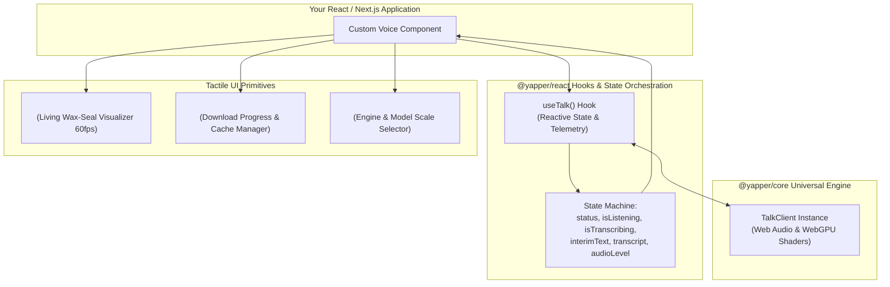

# @yapper/react

> **React hooks and tactile components for Yapper universal speech-to-text.**

[](https://opensource.org/licenses/MIT)
[](https://react.dev)

---

## ⚡ Features

- **`useTalk()` Hook**: One-line React hook providing reactive dictation status, interim text, finalized transcripts, audio levels, and engine controls.
- **Living Wax-Seal Orb (`<TalkOrb />`)**: Tactile, audio-reactive 60fps microphone button inspired by *Her*.
- **Hardware Controls (`<HardwareDrawer />`)**: Sliding drawer for engine selection (Instant Native 0ms vs On-Device WebGPU Whisper), model scale, and spoken tongue.
- **Model Download Card (`<LocalModelCard />`)**: Live progress indicators and cache controls for browser-cached neural weights.
- **Zero Configuration**: Bundles with dual CJS/ESM modules, TypeScript definitions, and externalized React peer dependencies.

---

## 🏗️ Architecture & Component Flow

The following diagram illustrates how `@yapper/react` connects tactile UI components, the `useTalk` hook state machine, and the underlying `@yapper/core` engine:



---

## 📦 Installation

```bash
# npm
npm install @yapper/react @yapper/core

# yarn
yarn add @yapper/react @yapper/core

# pnpm
pnpm add @yapper/react @yapper/core
```

---

## 🚀 Quickstart

```tsx
import React from 'react';
import { useTalk, TalkOrb } from '@yapper/react';

export function DictationApp() {
  const {
    status,
    transcript,
    interimText,
    audioLevel,
    start,
    stop,
    cancel,
    engine,
    setEngine,
  } = useTalk({
    engine: 'browser', // 'browser' (0ms instant) or 'local' (WebGPU Whisper)
    language: 'english',
    onFinal: (text) => {
      console.log('Committed speech:', text);
    },
  });

  return (
    <div className="flex flex-col items-center gap-6 p-8">
      {/* Living Wax-Seal Voice Orb */}
      <TalkOrb
        status={status}
        audioLevel={audioLevel}
        onToggle={() => {
          if (status === 'listening') stop();
          else start();
        }}
      />

      {/* Real-time transcript */}
      <div className="max-w-xl text-lg font-serif">
        <span>{transcript}</span>
        <span className="text-red-600 italic">{interimText}</span>
      </div>
    </div>
  );
}
```

---

## 🛠️ API Reference

### `useTalk(options?: UseTalkOptions)`

#### Parameters
- `engine?: 'browser' | 'local' | 'cloud'` (Default: `'browser'`)
- `modelSize?: 'tiny' | 'base' | 'small'` (Default: `'tiny'`)
- `language?: string` (Default: `'english'`)
- `onInterim?: (text: string) => void`
- `onFinal?: (text: string) => void`
- `onAudioLevel?: (rms: number) => void`
- `onStatusChange?: (status: TalkStatus) => void`

#### Return Value
- `status: TalkStatus` (`'idle' | 'listening' | 'processing' | 'ready' | 'needsModel' | 'error'`)
- `transcript: string` - Permanent finalized text
- `interimText: string` - Live streaming words
- `audioLevel: number` - 0.0 to 1.0 real-time microphone volume
- `start: () => Promise<TalkSession>`
- `stop: () => Promise<string>`
- `cancel: () => void`
- `loadModel: () => Promise<void>`
- `modelProgress: LocalModelDownloadProgress`

---

## 📄 License

MIT © Luis Enrique
